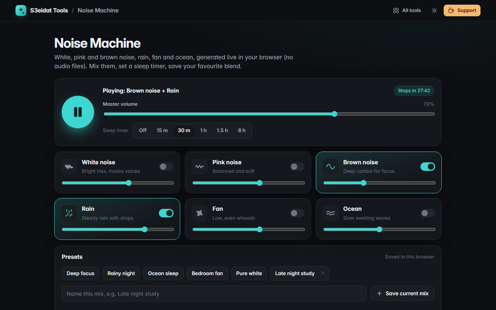

# Noise Machine

> White, pink and brown noise, rain, fan and ocean sounds for focus and sleep. Free, private, and it runs entirely in your browser.

### ▶ [Open Noise Machine](https://s3eidat.github.io/noise-machine/)



## Features

- Six sounds **generated live** with WebAudio, no audio files: **white, pink, brown noise, rain, fan, ocean**
- **Mixer**: turn any sounds on together, each with its own volume, plus a master volume
- Seamless loops (cross-faded), gentle fade-in, and a limiter so a loud mix never distorts
- **Sleep timer** (15 min to 8 h) that fades out over the last minute, then stops
- **Presets** (Deep focus, Rainy night, Ocean sleep, Bedroom fan, Pure white) and your **own presets**, saved in this browser
- Remembers your last mix; <kbd>Space</kbd> plays/pauses
- No binaural beats, no tracking, no ads

## Privacy

There is no server, no account, no analytics. The page ships with a strict Content-Security-Policy
(`connect-src 'self'`), so the browser itself blocks any attempt to send data anywhere.

## Run it yourself

It's plain HTML, CSS and JavaScript with no build step:

```bash
git clone https://github.com/s3eidat/noise-machine
cd noise-machine
python -m http.server 8000
```

Then open http://localhost:8000.

## Support

If this saved you time, **[buy me a coffee ☕](https://s3eidat.github.io/coffee/)**. It keeps every tool free.

---

Part of **[S3eidat Tools](https://s3eidat.github.io/)**: 100+ free, private tools that run in your browser. MIT licensed.
